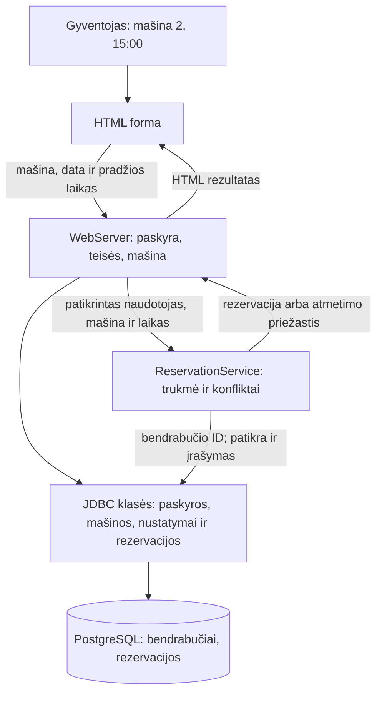

# Architektūros dokumentas

**Projektas.** Bendrabučių skalbyklų rezervavimo sistema leidžia gyventojui matyti laisvus laikus, rezervuoti savo bendrabučio skalbimo mašiną, peržiūrėti ir atšaukti savo būsimas rezervacijas. Vienas Java serveris aptarnauja du bendrabučius; jų įrašai ir rezervavimo trukmės atskirti pagal bendrabučio ID.

## Projektavimas galutinėje sistemoje

**Naudotojo veiksmas.** A bendrabučio gyventojas prisijungia ir formoje pasirenka mašiną Nr. 2 bei būsimą 15:00 laiką. Serveris nustato gyventojo bendrabutį pagal paskyrą, iš PostgreSQL paima tos mašinos ir bendrabučio nustatymus. Rezervavimo modulis apskaičiuoja pabaigos laiką, patikrina darbo valandas ir konfliktus. Jei laikas tinka, rezervacija įrašoma į DB ir puslapyje parodomas jos numeris; jei užimtas, grąžinama priežastis.

### Sistemos schema

| Komponentas | Atsakomybė šiame veiksme | Kodo vieta |
| --- | --- | --- |
| HTML | Pateikia mašinos, datos ir 24 valandų laiko laukus; rodo lietuviškai suformatuotą rezultatą | [page.html](src/main/resources/page.html), [WebServer.showHome](src/main/java/WebServer.java) |
| HTTP serveris | Patikrina prisijungimą, parenka savo bendrabučio mašiną ir perduoda duomenis moduliui | [WebServer](src/main/java/WebServer.java), [findMachine](src/main/java/WebServer.java), [createReservation](src/main/java/WebServer.java) |
| Rezervavimo modulis | Pagal nustatytą trukmę patikrina ateities laiką, darbo valandas ir persidengimą | [ReservationService.createReservation](src/main/java/ReservationService.java#L20) |
| Duomenų prieiga | Nuskaito bendrabučio nustatymą, jo mašinas ir rezervacijas; įrašo naują rezervaciją | [PostgresReservationSettingsSource](src/main/java/PostgresReservationSettingsSource.java#L19), [PostgresCatalog](src/main/java/PostgresCatalog.java), [PostgresReservationRepository](src/main/java/PostgresReservationRepository.java) |
| PostgreSQL | Saugo susietus bendrabučių, naudotojų, mašinų ir rezervacijų įrašus | [init.sql](database/init.sql), [accounts.sql](database/accounts.sql) |

**Projektavimo pasirinkimas.** [ReservationService konstruktorius](src/main/java/ReservationService.java#L13) gauna dvi nedideles sąsajas: `ReservationStore` rezervacijoms ir `ReservationSettingsSource` bendrabučio nustatymams. Todėl rezervavimo taisyklėse nėra SQL ar visiems bendrabučiams įrašytos vienos trukmės. Veikiančioje sistemoje sąsajas įgyvendina PostgreSQL klasės, o vienetiniuose testuose naudojama atminties saugykla ir fiksuotas laikrodis. Tai leidžia tą pačią taisyklę išbandyti be DB ir pakeisti A nustatymą nekopijuojant algoritmo.

**Nedidelis pakeitimas ir patikrinimas.** Jei rezervavimo pradžia ir laisvi laikai turėtų būti kas 15, o ne kas 30 minučių, `ReservationService.START_STEP_MINUTES` pakeisčiau iš 30 į 15 ir pritaikyčiau šios klasės klaidos pranešimą apie leidžiamas minutes. Ta pati konstanta naudojama laisvų laikų sąrašui, rezervavimo patikrai ir minučių pasirinkimui puslapyje. Teste su fiksuotu 2030-11-19 12:00 UTC laiku, tuščia mašina ir 2030-11-20 data sąraše turėtų atsirasti 07:15, rezervavimas 07:15 turėtų pavykti, o 07:10 – būti atmestas. Esamą 30 minučių žingsnio testą taip pat pritaikyčiau naujai taisyklei. Šis pakeitimas dabar **neatliktas**; tai konkretaus mažo pakeitimo ir jo testo pavyzdys.

## Pagrindinis kokybės atributas

**Atributas ir sprendimas.** [I etapo plane](I_etapas_projektavimo_dokumentas.md) pasirinktas **palaikomumas**: A bendrabučio trukmę pakeitus iš 60 į 90 minučių, B turi likti 60 minučių, o rezervavimo taisyklių nereikia perrašyti. Kiekvieno bendrabučio trukmė saugoma `dormitories.reservation_minutes`. [PostgresReservationSettingsSource](src/main/java/PostgresReservationSettingsSource.java#L19) ją skaito pagal bendrabučio ID, o [ReservationService](src/main/java/ReservationService.java#L20) naudoja gautą reikšmę.

**Pakartojamas bandymas.** Reikia veikiančio Docker Desktop ir [README](README.md) komandos `docker compose up --build -d`. Pradinėje DB A ir B trukmės yra 60 minučių. A administratorius `admin_1` nustato 90, B administratorius `admin_2` mato 60. Abu gyventojai savo bendrabučio mašinai Nr. 2 pasirenka tą pačią būsimą datą ir 15:00. A naujos rezervacijos pabaiga turi būti 16:30, B – 16:00. Jei DB jau naudota, prieš bandymą administratorių formose abi trukmes reikia nustatyti į 60. Automatiniam bandymui vykdoma `docker compose run --build --rm app mvn test`.

| I etape nustatytas sėkmės kriterijus | Faktinis rezultatas | Išvada ir įrodymas |
| --- | --- | --- |
| A nauja rezervacija – 90 min., B – 60 min.; pagrindinio algoritmo nereikia dubliuoti | [ReservationSettingsTest.changingOneDormitoryDurationDoesNotChangeTheOther](src/test/java/ReservationSettingsTest.java#L21) patikrina abi pabaigas, [WebServerIntegrationTest.serverChecksLoginRoleTenantAndSettings](src/test/java/WebServerIntegrationTest.java#L21) patikrina DB nustatymus ir naujas rezervacijas | Pasiekta: vienas `ReservationService` veikia abiem bendrabučiams |
| Pakeitus A, B nustatymas lieka toks pats, o ankstesnės taisyklės tebeveikia | DB integracijos testas patikrina B reikšmę; 2026-11-22 Docker paleisti 30 testų, 0 nesėkmių, 0 klaidų, 0 praleidimų | Pasiekta vietiniame bandyme; komanda ir sąlygos pateiktos [README](README.md) |

## SaaS veikimas ir paleidimas

**Prisijungimas ir klientų izoliacija.** Prisijungimo forma per `PostgresAccounts.authenticate` patikrina slaptažodį DB. `WebServer` sukuria atsitiktinį sesijos žetoną, laiko jį Java atmintyje 8 valandas ir naršyklei siunčia `HttpOnly` slapuką. Atsijungimas panaikina žetoną. Bendrabučio ID ir rolė gaunami iš patikrintos paskyros, o `allowedDormitory` atmeta kito bendrabučio ID. Mašinų ir rezervacijų užklausos ribojamos tuo ID. A gyventojo užklausa dėl B duomenų grąžina 403.

**Rolės.** [WebServer.changeSettings](src/main/java/WebServer.java) ir [createResident](src/main/java/WebServer.java) leidžiami tik `ADMIN`. Gyventojo bandymas keisti trukmę grąžina 403; A administratorius gali pakeisti A trukmę ir sukurti A gyventojo paskyrą. Kuriant paskyrą bendrabutis imamas iš administratoriaus paskyros, ne iš formos. Įrodymas: [WebServerIntegrationTest.administratorCreatesResidentOnlyInOwnDormitory](src/test/java/WebServerIntegrationTest.java#L149).

**Kliento konfigūracija.** A administratorius keičia tik A `reservation_minutes` įrašą per [PostgresSettingsAdmin.changeDuration](src/main/java/PostgresSettingsAdmin.java#L17). B reikšmė lieka 60. Rezervuojant nuo 15:00, A pabaiga 16:30, B 16:00; serveris kiekvieną kartą paima prisijungusio gyventojo bendrabučio nustatymą.

**API užklausa.** `GET /api/reservations` naršyklėje naudoja tą patį sesijos slapuką. Tiesioginėms API užklausoms be slapuko galima siųsti `Authorization: Basic`: tokia užklausa atskirai patikrinama DB. Naršyklės HTML puslapiai `Basic` antraštę ignoruoja, todėl iš jų galima patikimai atsijungti. Su `Basic` antrašte serveris iš pačios užklausos gauna prisijungimo duomenis, DB patikrina paskyrą ir jos bendrabutį, tada rezervacijas skaito iš DB. Todėl šią užklausą gali aptarnauti kitas serverio procesas be ankstesnio prisijungimo savo atmintyje. Patikroje du serverio egzemplioriai naudojo tą pačią DB: pirmojo sesijos slapukas antrajame grąžino 401, o atskira `Basic` užklausa – 200. Šis nepriklausomumas taikomas tiesioginėms JSON API skaitymo užklausoms; HTML formos naudoja serverio sesiją. Po serverio perkrovimo atmintyje laikytos sesijos nebegalioja.

**Vietinis paleidimas.** [README](README.md) nurodo pradinį pasiruošimą ir vieną paleidimo komandą: `docker compose up --build -d`. [compose.yaml](compose.yaml) perduoda `JDBC_URL`, `DB_USER`, `DB_PASSWORD` ir `PORT`, taip pat `TZ=Europe/Vilnius` Java konteineriui, o PostgreSQL konteineriui – DB pavadinimą bei prisijungimo duomenis. `setup` konteineris vykdo [accounts.sql](database/accounts.sql). Visi demonstraciniai prievadai pririšti prie `127.0.0.1`.

## Architektūros dokumentas ir AI

### Kas pasikeitė nuo I etapo ir kodėl

| I etapo planas | Įgyvendintas sprendimas | Priežastis ir pasekmė |
| --- | --- | --- |
| Java, reliacinė DB, paprasta sąsaja ir užklausos be serverio sesijos | Java 21 HTTP serveris, PostgreSQL, HTML formos ir dvi JSON GET užklausos; patogiam paskyrų keitimui naršyklė naudoja serverio sesiją | Išlaikyta paprasta sąsaja; nuo pradinės idėjos nukrypta tik naršyklės prisijungimui ir atsijungimui. Tiesioginė API `Basic` užklausa gali būti apdorota be sesijos. |
| A ir B trukmės nustatomos atskirai, rezervavimo taisyklė bendra | `reservation_minutes` laikoma kiekvieno bendrabučio DB eilutėje | 90/60 bandymas patvirtina I etapo palaikomumo tikslą |
| I etape pagrindinis modulis ir keturios gyventojo funkcijos; administratorius numatytas vėlesniam etapui | Išliko tos pačios gyventojo funkcijos, pridėti prisijungimas, administratoriaus trukmės keitimas ir paskyros kūrimas | Įgyvendintos III etapo rolės ir kliento nustatymas, nepakeičiant patvirtintos rezervavimo idėjos |

I etapo plane ateičiai minėtas ir administratoriaus mašinų valdymas. Šiame variante mašinos sukuriamos pradiniais DB duomenimis; administratoriaus forma joms kurti neįgyvendinta. Keturios I etapo gyventojo funkcijos įgyvendintos. Tai sąmoningai apribota apimtis pagal III etapo bazinius kriterijus.

### AI panaudojimas

| Priemonė ir paskirtis | Panaudota | Atmesta ar pakeista ir kodėl | Patikrinimas |
| --- | --- | --- | --- |
| ChatGPT/Codex: Java, SQL, testų pagalba | HTTP maršrutų, JDBC prieigos, rezervavimo ir testų kodas; vėliau prisijungimo forma su atsijungimu | Sprendimas išliko be JavaScript karkaso | 2026-11-22 sėkmingai paleisti visi 30 testų su PostgreSQL, įskaitant prisijungimo ir paskyrų keitimo patikrą |
| ChatGPT/Codex: dokumento tekstas | README ir šio dokumento struktūros juodraščiai | Sutikrinta su I etapo planu, galutiniu kodu ir III etapo šablonu; pašalinti neįgyvendintų funkcijų pažadai | Metodų, failų ir bandymo rezultatų patikra |
| Gemini Pro: I etapo plano peržiūra | I etape aptarti plano pasiūlymai; galutiniame kode Gemini nenaudojamas | Nepasirinkti nepatikrinti arba šiai apimčiai nereikalingi pasiūlymai | I etapo dokumento palyginimas su užduoties reikalavimais |

AI nėra sistemos funkcija: rezervavimo sprendimą priima Java taisyklės pagal DB duomenis.

**Įgyvendinimo riba.** Dabartinis konfliktų tikrinimas atmeta nuosekliai pateiktas persidengiančias rezervacijas. `synchronized` neleidžia dviem to paties Java proceso užklausoms vienu metu atlikti rezervacijos patikrinimo ir įrašymo. Dvi visiškai vienu metu vykdomos užklausos iš atskirų serverio procesų neturi papildomo DB apribojimo. Tokia konkurencinė situacija šiame vietiniame variante negarantuojama.
