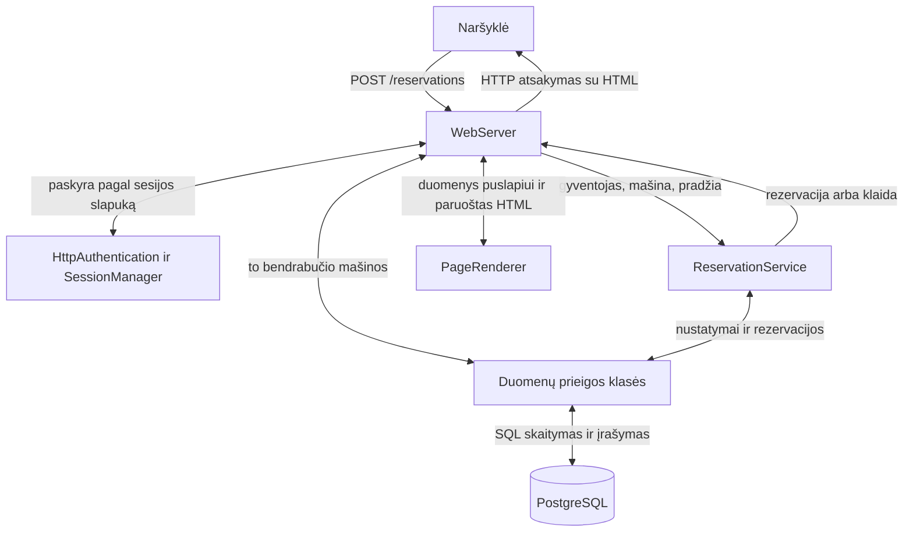

# Architektūros dokumentas

**Projektas.** Bendrabučių skalbyklų rezervavimo sistema. Vienas Java serveris aptarnauja du bendrabučius. Gyventojas gali rasti laisvą laiką, rezervuoti savo bendrabučio skalbimo mašiną ir peržiūrėti arba atšaukti savo būsimas rezervacijas. Kiekvieno bendrabučio trukmė ir įrašai saugomi pagal jo ID.

## Projektavimas galutinėje sistemoje

A bendrabučio gyventojas pasirenka mašiną Nr. 2 ir būsimą datą, pavyzdžiui, 2031-01-15. Jis nori rezervuoti nuo 15:00. Kai A bendrabučio trukmė yra 90 minučių ir laikas laisvas, rezervacija baigiasi 16:30.

### Sistemos schema



### Rezervacijos kelias kode

1. `WebServer` pagal sesijos slapuką nustato paskyrą. Tada `routeAuthenticatedRequest` pagal metodą ir adresą `POST /reservations` parenka `handleReservationCreation`. [Maršrutas](src/main/java/WebServer.java#L95)
2. `handleReservationCreation` patikrina gyventojo rolę ir bendrabutį, perskaito formos laukus per `RequestFields` ir suranda mašiną gyventojo bendrabutyje. [Formos apdorojimas](src/main/java/WebServer.java#L138)
3. `createReservation` pagal bendrabučio ID gauna trukmę ir apskaičiuoja pabaigą. Metodas patikrina, ar pradžia ateityje ir atitinka 30 min. žingsnį, ar laikas telpa į darbo valandas ir ar tuo metu mašina laisva ir gyventojas neturi kitos rezervacijos. Laisvų laikų paieška naudoja tas pačias konfliktų patikras. [Rezervavimo taisyklės](src/main/java/ReservationService.java#L20)
4. Jei patikros sėkmingos, `save` įrašo rezervaciją į PostgreSQL. `PageRenderer` paruošia HTML, o `WebServer` grąžina puslapį su rezervacijos numeriu. Jei pasirinktas laikas užimtas, serveris grąžina HTML su atmetimo priežastimi ir HTTP 400. [Įrašymas į DB](src/main/java/PostgresReservationRepository.java#L39) · [Klaidos atsakymas](src/main/java/WebServer.java#L261)

| Komponentas | Atsakomybė šiame veiksme | Kodo vieta |
| --- | --- | --- |
| HTML pateikimas | `PageRenderer` iš serverio perduotų duomenų sukuria formas, laisvų laikų ir rezervacijų sąrašus | [PageRenderer](src/main/java/PageRenderer.java), [page.html](src/main/resources/page.html) |
| Formos nuskaitymas | Perskaito pateiktus laukus ir iš datos bei laiko sudaro rezervacijos pradžią | [RequestFields](src/main/java/RequestFields.java) |
| HTTP prisijungimas | Tikrina prisijungimo duomenis, nustato paskyrą pagal slapuką arba API antraštę ir tvarko sesijos slapuką | [HttpAuthentication](src/main/java/HttpAuthentication.java) |
| Sesijų valdymas | Sukuria, suranda ir panaikina atmintyje laikomas sesijas | [SessionManager](src/main/java/SessionManager.java) |
| HTTP serveris | Pagal HTTP metodą ir adresą parenka veiksmą, tikrina prieigą, suranda bendrabučio mašiną ir kviečia rezervavimo modulį | [WebServer](src/main/java/WebServer.java), [findMachineInOwnDormitory](src/main/java/WebServer.java#L251), [handleReservationCreation](src/main/java/WebServer.java#L138) |
| Rezervavimo modulis | Pagal nustatytą trukmę patikrina ateities laiką, darbo valandas ir persidengimą | [ReservationService.createReservation](src/main/java/ReservationService.java#L20) |
| Duomenų prieiga | Nuskaito bendrabučio nustatymą, mašinas ir rezervacijas. Įrašo naują rezervaciją. | [PostgresReservationSettingsRepository](src/main/java/PostgresReservationSettingsRepository.java#L19), [PostgresMachineCatalog](src/main/java/PostgresMachineCatalog.java), [PostgresReservationRepository](src/main/java/PostgresReservationRepository.java) |
| PostgreSQL | Saugo susietus bendrabučių, naudotojų, mašinų ir rezervacijų įrašus | [init.sql](database/init.sql), [accounts.sql](database/accounts.sql) |

**Projektavimo pasirinkimas.** `ReservationService` per `ReservationStore` gauna ir saugo rezervacijas, o per `ReservationSettingsSource` perskaito bendrabučio nustatymus. Veikiančioje sistemoje duomenis teikia PostgreSQL klasės. Vienetiniame teste tas pats servisas naudoja atminties saugyklą ir fiksuotą laikrodį. Taip rezervavimo taisykles galima išbandyti atskirai nuo duomenų bazės. [Serviso konstruktorius](src/main/java/ReservationService.java#L13) · [Atminties saugykla](src/main/java/InMemoryReservationRepository.java)

**Pakeitimo pavyzdys.** Norint pereiti nuo 30 prie 15 minučių žingsnio, pakeisčiau `START_STEP_MINUTES` ir atnaujinčiau netinkamo laiko pranešimą. Tą pačią konstantą naudoja rezervavimo patikra, laisvų laikų paieška ir formos minučių sąrašas. Patikrinčiau, ar būsimą dieną laisvai mašinai galima pasirinkti ir rezervuoti laiką nuo 07:15, o bandymas rezervuoti nuo 07:10 atmetamas. Dabartiniame HTTP teste netinkamos pradžios pavyzdys yra 13:33. [Laiko žingsnis](src/main/java/ReservationService.java#L8) · [Formos minutės](src/main/java/PageRenderer.java#L131) · [HTTP testas](src/test/java/WebServerIntegrationTest.java#L99)

**II etapo funkcijos išliko.** [ReservationServiceTest](src/test/java/ReservationServiceTest.java) tikrina rezervacijos sukūrimą, svetimo bendrabučio mašinos atmetimą, praeities laiko ir darbo valandų ribas, mašinos bei gyventojo konfliktus ir bendrabučių atskyrimą. [WebServerIntegrationTest.residentCanCheckAvailabilityBookAndCancel](src/test/java/WebServerIntegrationTest.java#L99) tikrina laisvų laikų peržiūrą, rezervacijos sukūrimą, perskaitymą, konflikto atmetimą ir atšaukimą per HTTP. Per gynimą šie testai paleidžiami kartu su kitais žemiau nurodyta komanda.

## Pagrindinis kokybės atributas

**Palaikomumas.** Bendrabučio administratorius trukmę gali pritaikyti savo bendrabučiui per nustatymus. I etapo tikslas buvo patikrinti tokio pakeitimo poveikį abiem bendrabučiams. Bandymo pradžioje abu bendrabučiai naudoja 60 min. Pakeitus A reikšmę į 90 min., jo nauja rezervacija turi trukti 90 min., B rezervacija – 60 min. Abiem atvejais turi veikti tas pats rezervavimo metodas ir taisyklių testai. [I etapo planas](I_etapas_projektavimo_dokumentas.md)

**Kur tai matyti kode.** `updateReservationDuration` atnaujina `dormitories.reservation_minutes` pagal bendrabučio ID. `findForDormitory` perskaito reikšmę, o `createReservation` prideda ją prie pradžios laiko. [Trukmės įrašymas](src/main/java/PostgresReservationSettingsRepository.java#L39) · [Trukmės skaitymas](src/main/java/PostgresReservationSettingsRepository.java#L19) · [Pabaigos skaičiavimas](src/main/java/ReservationService.java#L29)

**Pakartojamas bandymas.** Aplinka – veikiantis Docker Desktop ir pagal [README](README.md#paleidimas) paleista sistema. Prisijungimo duomenys pateikti tame pačiame README.

1. Abiejų administratorių formose nustatyti A ir B trukmes į 60 minučių. Tai svarbu ir pakartotinai naudojant DB.
2. Pasirinkti tą pačią būsimą datą, kai 15:00–16:30 intervale abu gyventojai ir abiejų bendrabučių mašinos Nr. 2 neturi rezervacijų.
3. A administratoriui pakeisti tik A trukmę į 90 minučių. Prisijungus B administratoriumi patikrinti, kad B liko 60 minučių.
4. Abiem gyventojams savo bendrabučio mašiną Nr. 2 rezervuoti nuo 15:00. Palyginti naujų rezervacijų pabaigas: A turi būti 16:30, B – 16:00.
5. Paleisti `docker compose run --build --rm app mvn test` ir patikrinti, kad nėra nesėkmių, klaidų ar praleistų testų.

| Sėkmės kriterijus | Faktinis rezultatas | Išvada ir įrodymas |
| --- | --- | --- |
| Pakeitus A trukmę iš 60 į 90 min., B turi likti 60 min. Nuo 15:00 A rezervacija turėtų baigtis 16:30, B – 16:00. | 2026-11-23 bandyme su nauja demonstracine PostgreSQL baze gautas būtent toks rezultatas. Abi pabaigas parodė rezervacijų API. | Tikslas pasiektas. [Integracinis testas](src/test/java/WebServerIntegrationTest.java#L51) atskirai patikrina, kad per HTTP pakeitus A nustatymą, B reikšmė išlieka pradinė. |
| Abiem bendrabučiams turi veikti tas pats rezervavimo metodas ir rezervavimo taisyklių testai. | Pakako pakeisti A nustatymą. Abiejų rezervacijų pabaigą apskaičiavo tas pats metodas. Visi 13 testų praėjo. | Tikslas pasiektas. [Rezervavimo metodas](src/main/java/ReservationService.java#L20) naudoja bendrabučio nustatymus. [Vienetinis testas](src/test/java/ReservationSettingsTest.java#L21) patikrina abi pabaigas su 90 ir 60 min. trukmėmis. |

Bandymo aplinka: macOS, Docker Desktop, Java 21 ir Maven konteineryje, PostgreSQL 17. Iš 13 testų 9 yra vienetiniai, 4 – su tikra DB. 2026-11-23 17:54 gauta Maven rezultatų suvestinė.

```text
Tests run: 13, Failures: 0, Errors: 0, Skipped: 0
BUILD SUCCESS
```

## SaaS veikimas ir paleidimas

**Prisijungimas.** `HttpAuthentication.signIn` per `PostgresAccounts` patikrina slaptažodį. Jei prisijungti pavyksta, `SessionManager` sukuria sesiją, o naršyklė gauna `HttpOnly` slapuką. Sesija galioja iki 8 valandų. Atsijungus `signOut` ją panaikina. [Prisijungimo ir atsijungimo kodas](src/main/java/HttpAuthentication.java#L17) · [Atsijungimo testas](src/test/java/WebServerIntegrationTest.java#L145)

**Bendrabučių atskyrimas.** Serveris gauna bendrabučio ID iš patikrintos paskyros. A gyventojui paprašius B bendrabučio duomenų per API, `requireOwnDormitory` grąžina 403. Atšaukiant rezervaciją, `cancelReservation` jos ieško gyventojo bendrabutyje ir patikrina savininką bei pradžios laiką. Rankiniame bandyme A gyventojo bandymas atšaukti B rezervaciją grąžino 400, o B įrašas išliko. [Bendrabučio patikra](src/main/java/WebServer.java#L227) · [Atšaukimo taisyklė](src/main/java/ReservationService.java#L163) · [Izoliavimo testas](src/test/java/ReservationServiceTest.java#L80)

**Rolės.** Per `POST /admin/settings` A administratorius savo bendrabučiui gali nustatyti 90 min. ir gauna 200. Gyventojas už tą patį veiksmą gauna 403. Jei A administratorius nurodo B bendrabutį, serveris grąžina 403. Tas pats rolės patikrinimas taikomas kuriant gyventojo paskyrą. Nauja paskyra priskiriama administratoriaus bendrabučiui. [Trukmės keitimas](src/main/java/WebServer.java#L157) · [Paskyros kūrimas](src/main/java/WebServer.java#L166) · [Teisių ir trukmės testas](src/test/java/WebServerIntegrationTest.java#L51)

Norint pakartoti svetimos rezervacijos atšaukimo bandymą, B gyventojas sukuria būsimą rezervaciją ir užsirašo jos numerį. A gyventojas prisijungia žemiau pateikta komanda, o `B_REZERVACIJOS_ID` pakeičia tuo tikru numeriu:

```bash
curl -i -c /tmp/laundry-a.cookies -d 'login=student_1_101&password=student_demo' http://localhost:8080/login
curl -i -b /tmp/laundry-a.cookies -d 'reservationId=B_REZERVACIJOS_ID' http://localhost:8080/cancel
```

Tikimasi 303 po prisijungimo ir 400 po atšaukimo bandymo. B gyventojas atnaujina savo puslapį ir patikrina, kad rezervacija išliko. Naršyklės ir terminalo sesijos yra atskiros.

**Kliento konfigūracija.** A administratoriui pakeitus A trukmę į 90 min., B liko 60 min. Tai matyti ir abiejų rezervacijų pabaigose. Bandymo eiga ir rezultatai pateikti [palaikomumo skyriuje](#pagrindinis-kokybės-atributas).

**API užklausa.** Naršyklėje `GET /api/reservations` gali naudoti sesijos slapuką. Tiesioginė užklausa gali perduoti prisijungimo duomenis per `Authorization: Basic`. Serveris juos patikrina PostgreSQL gavęs konkrečią užklausą ir perskaito tai paskyrai prieinamas rezervacijas. Tokiai užklausai pakanka jos antraštės ir DB duomenų, todėl ją galima pateikti iškart po serverio paleidimo. [Paskyros nustatymas](src/main/java/HttpAuthentication.java#L37) · [JSON atsakymas](src/main/java/WebServer.java#L176)

API prisijungimo patikrą galima pakartoti be ankstesnio prisijungimo ir be slapukų failo:

```bash
curl -i http://localhost:8080/api/reservations
curl -i -u student_1_101:student_demo http://localhost:8080/api/reservations
curl -i -u student_1_101:neteisingas http://localhost:8080/api/reservations
```

2026-11-22 rankinio bandymo rezultatai: atitinkamai 401, 200 su JSON rezervacijomis ir 401. Įvesties `dormitoryId=2` tikrinimui antrai užklausai pridėjus `?dormitoryId=2` tikimasi 403; API adresą su parametru terminale reikia apgaubti kabutėmis.

**Vietinis paleidimas.** [README](README.md) nurodo pradinį pasiruošimą ir vieną paleidimo komandą: `docker compose up --build -d`. [compose.yaml](compose.yaml) perduoda `JDBC_URL`, `DB_USER`, `DB_PASSWORD` ir `PORT`, taip pat `TZ=Europe/Vilnius` Java konteineriui, o PostgreSQL konteineriui – DB pavadinimą bei prisijungimo duomenis. `setup` konteineris vykdo [accounts.sql](database/accounts.sql). Visi demonstraciniai prievadai pririšti prie `127.0.0.1`. Prieš paleidimą turi būti laisvi vietiniai 8080 ir 5433 prievadai; kitą juos naudojančią programą ar ankstesnę projekto versiją reikia sustabdyti. Rankiniame bandyme po `docker compose down` ir `docker compose up -d` rezervacijos, klientų nustatymai bei paskyros išliko PostgreSQL tome. Duomenų išlikimo bandyme `down` vykdomas be `-v`.

## Architektūros dokumentas ir AI

### Kas pasikeitė nuo I etapo ir kodėl

**Pradinis projektas:** [I etapo projektavimo dokumentas](I_etapas_projektavimo_dokumentas.md), ypač „Kokybės atributas“ ir „Pradinė sistemos struktūra“. Palaikomumo atributas ir jo 90/60 minučių tikslas nepakeisti.

| I etapo planas | Įgyvendintas sprendimas | Priežastis ir pasekmė |
| --- | --- | --- |
| Java, reliacinė DB, paprasta sąsaja ir užklausos be serverio sesijos | Java 21 HTTP serveris, PostgreSQL, HTML formos ir dvi JSON GET užklausos; patogiam paskyrų keitimui naršyklė naudoja serverio sesiją | Išlaikyta paprasta sąsaja; nuo pradinės idėjos nukrypta tik naršyklės prisijungimui ir atsijungimui. Tiesioginė API `Basic` užklausa gali būti apdorota be sesijos. |
| A ir B trukmės nustatomos atskirai, rezervavimo taisyklė bendra | `reservation_minutes` laikoma kiekvieno bendrabučio DB eilutėje | 90/60 bandymas patvirtina I etapo palaikomumo tikslą |
| I etape pagrindinis modulis ir keturios gyventojo funkcijos; administratorius numatytas vėlesniam etapui | Išliko tos pačios gyventojo funkcijos, pridėti prisijungimas, administratoriaus trukmės keitimas ir paskyros kūrimas | Įgyvendintos III etapo rolės ir kliento nustatymas, nepakeičiant patvirtintos rezervavimo idėjos |

I etapo plane ateičiai minėtas ir administratoriaus mašinų valdymas. Mašinos sukuriamos iš pradinių DB duomenų. Administratorius gali keisti trukmę ir kurti gyventojų paskyras. Keturios I etapo gyventojo funkcijos įgyvendintos. Tai sąmoningai apribota apimtis pagal III etapo bazinius kriterijus.

### AI panaudojimas

| Priemonė ir paskirtis | Panaudota | Atmesta ar pakeista ir kodėl | Patikrinimas |
| --- | --- | --- | --- |
| ChatGPT/Codex: Java, SQL, testų pagalba | HTTP maršrutų, JDBC prieigos, rezervavimo ir testų kodas; vėliau prisijungimo forma su atsijungimu ir HTML perkėlimas į `PageRenderer`, prisijungimo ir slapukų tvarkymas `HttpAuthentication` klasėje bei sesijų saugojimas `SessionManager` klasėje | Pasirinktas paprastas HTML be JavaScript karkaso, kad sąsają būtų lengva suprasti ir paaiškinti; rezervavimo taisyklės paliktos Java modulyje. Kodo peržiūros metu iš HTML pašalinta atsitiktinai įklijuota terminalo komanda | Galutiniame rinkinyje 13 testų. HTTP testai patikrino prisijungimą, teises ir sesijos panaikinimą atsijungus. |
| ChatGPT/Codex: dokumento tekstas | README ir šio dokumento struktūros juodraščiai | Patikslinti schemos ir API aprašai: taisyklių tikrinimas priskirtas rezervavimo moduliui, aiškiai atskirtos sesijos ir nepriklausomos `Basic` užklausos. | Schemos veiksmai sutikrinti su Java metodais, o 90/60 bandymo rezultatai – su testų patikromis. |
| Gemini Pro: I etapo plano peržiūra | I etape aptarti plano pasiūlymai; galutiniame kode Gemini nenaudojamas | Nepasirinkti nepatikrinti arba šiai apimčiai nereikalingi pasiūlymai | I etapo dokumento palyginimas su užduoties reikalavimais |

AI nėra sistemos funkcija: rezervavimo sprendimą priima Java taisyklės pagal DB duomenis.

**Lygiagrečios užklausos.** Viename serveryje `synchronized` užtikrina, kad rezervacijos tikrinimas ir įrašymas per tą patį `ReservationService` objektą vyksta po vieną. Paleidus kelis serverio procesus, bendrą apsaugą nuo vienalaikių persidengimų reikėtų užtikrinti PostgreSQL.
