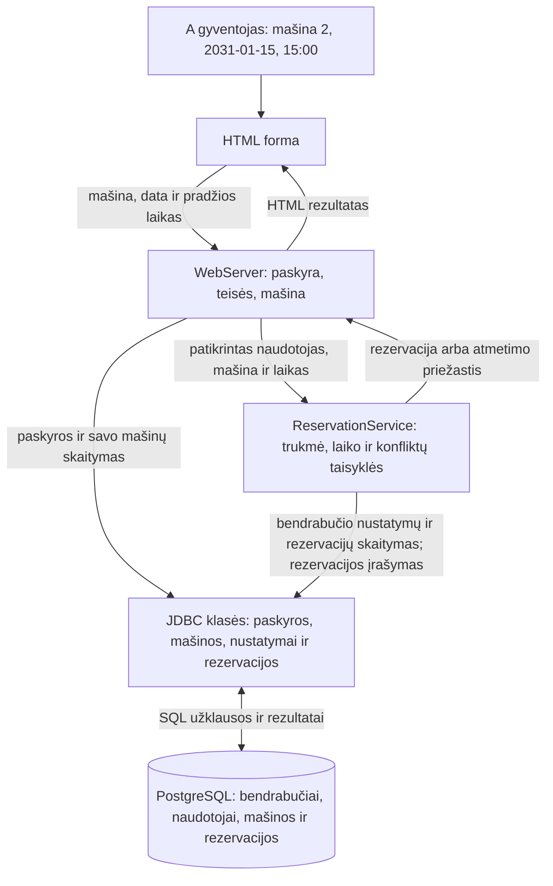

# Architektūros dokumentas

**Projektas.** Bendrabučių skalbyklų rezervavimo sistema leidžia gyventojui matyti laisvus laikus, rezervuoti savo bendrabučio skalbimo mašiną, peržiūrėti ir atšaukti savo būsimas rezervacijas. Vienas Java serveris aptarnauja du bendrabučius; jų įrašai ir rezervavimo trukmės atskirti pagal bendrabučio ID.

## Projektavimas galutinėje sistemoje

**Naudotojo veiksmas.** A bendrabučio gyventojas prisijungia ir formoje pasirenka mašiną Nr. 2 bei būsimą datą, pavyzdžiui, 2031-01-15, ir 15:00 laiką. A bendrabučio trukmė šiame scenarijuje – 90 minučių; sėkmės atveju sukuriama 15:00–16:30 rezervacija. Serveris nustato gyventojo bendrabutį pagal paskyrą, iš PostgreSQL paima tos mašinos ir bendrabučio nustatymus. Rezervavimo modulis apskaičiuoja pabaigos laiką, patikrina darbo valandas ir konfliktus. Jei laikas tinka, rezervacija įrašoma į DB ir puslapyje parodomas jos numeris; jei užimtas, grąžinama priežastis.

### Sistemos schema



| Komponentas | Atsakomybė šiame veiksme | Kodo vieta |
| --- | --- | --- |
| HTML | Pateikia mašinos, datos ir 24 valandų laiko laukus; rodo lietuviškai suformatuotą rezultatą | [page.html](src/main/resources/page.html), [WebServer.showHome](src/main/java/WebServer.java#L355) |
| HTTP serveris | Patikrina prisijungimą, parenka savo bendrabučio mašiną ir perduoda duomenis moduliui | [WebServer](src/main/java/WebServer.java), [findMachine](src/main/java/WebServer.java#L245), [createReservation](src/main/java/WebServer.java#L273) |
| Rezervavimo modulis | Pagal nustatytą trukmę patikrina ateities laiką, darbo valandas ir persidengimą | [ReservationService.createReservation](src/main/java/ReservationService.java#L20) |
| Duomenų prieiga | Nuskaito bendrabučio nustatymą, jo mašinas ir rezervacijas; įrašo naują rezervaciją | [PostgresReservationSettingsSource](src/main/java/PostgresReservationSettingsSource.java#L19), [PostgresCatalog](src/main/java/PostgresCatalog.java), [PostgresReservationRepository](src/main/java/PostgresReservationRepository.java) |
| PostgreSQL | Saugo susietus bendrabučių, naudotojų, mašinų ir rezervacijų įrašus | [init.sql](database/init.sql), [accounts.sql](database/accounts.sql) |

**Projektavimo pasirinkimas.** [ReservationService konstruktorius](src/main/java/ReservationService.java#L13) gauna dvi nedideles sąsajas: `ReservationStore` rezervacijoms ir `ReservationSettingsSource` bendrabučio nustatymams. Todėl rezervavimo taisyklėse nėra SQL ar visiems bendrabučiams įrašytos vienos trukmės. Veikiančioje sistemoje sąsajas įgyvendina PostgreSQL klasės, o vienetiniuose testuose naudojama atminties saugykla ir fiksuotas laikrodis. Tai leidžia tą pačią taisyklę išbandyti be DB ir pakeisti A nustatymą nekopijuojant algoritmo.

**Nedidelis pakeitimas ir patikrinimas.** Jei rezervavimo pradžia ir laisvi laikai turėtų būti kas 15, o ne kas 30 minučių, `ReservationService.START_STEP_MINUTES` pakeisčiau iš 30 į 15 ir pritaikyčiau šios klasės klaidos pranešimą apie leidžiamas minutes. Ta pati konstanta naudojama laisvų laikų sąrašui, rezervavimo patikrai ir minučių pasirinkimui puslapyje. Teste su fiksuotu 2030-11-19 12:00 UTC laiku, tuščia mašina ir 2030-11-20 data sąraše turėtų atsirasti 07:15, rezervavimas 07:15 turėtų pavykti, o 07:10 – būti atmestas. Esamą 30 minučių žingsnio testą taip pat pritaikyčiau naujai taisyklei. Šis pakeitimas dabar **neatliktas**; tai konkretaus mažo pakeitimo ir jo testo pavyzdys. Dabartinę 30 minučių taisyklę tikrina [ReservationServiceTest.acceptsOnlyHalfHourStartTimesShownAsAvailable](src/test/java/ReservationServiceTest.java#L45).

**II etapo funkcijos išliko.** [ReservationServiceTest](src/test/java/ReservationServiceTest.java) tikrina rezervacijos sukūrimą, laiko ribas, konfliktus ir gyventojų bei bendrabučių atskyrimą. [WebServerIntegrationTest.residentCanBookReadAndCancelThroughHttp](src/test/java/WebServerIntegrationTest.java#L79) tikrina rezervacijos sukūrimą, perskaitymą, konflikto atmetimą ir atšaukimą per HTTP. Per gynimą šie testai paleidžiami kartu su kitais žemiau nurodyta komanda.

## Pagrindinis kokybės atributas

**Atributas ir sprendimas.** [I etapo plane](I_etapas_projektavimo_dokumentas.md) pasirinktas **palaikomumas**: A bendrabučio trukmę pakeitus iš 60 į 90 minučių, B turi likti 60 minučių, o rezervavimo taisyklių nereikia perrašyti. Kiekvieno bendrabučio trukmė saugoma `dormitories.reservation_minutes`. [PostgresReservationSettingsSource](src/main/java/PostgresReservationSettingsSource.java#L19) ją skaito pagal bendrabučio ID, o [ReservationService](src/main/java/ReservationService.java#L20) naudoja gautą reikšmę.

**Kaip vertinau atributą.** Palaikomumą vertinau pagal I etape pasirinktą nustatymo pakeitimo scenarijų. Tikrinau tris dalykus: ar A nustatymas pakeičia jo naujos rezervacijos trukmę, ar B elgesys išlieka toks pats ir ar esami rezervavimo taisyklių testai tebėra sėkmingi. Kodo peržiūroje patikrinau, kad abiem bendrabučiams naudojamas tas pats rezervavimo metodas, o trukmė gaunama iš bendrabučio nustatymų.

**Pakartojamas bandymas.** Aplinka – veikiantis Docker Desktop ir pagal [README](README.md#paleidimas) paleista sistema. Prisijungimo duomenys pateikti tame pačiame README.

1. Abiejų administratorių formose nustatyti A ir B trukmes į 60 minučių. Tai svarbu ir pakartotinai naudojant DB.
2. Pasirinkti tą pačią būsimą datą, kai 15:00–16:30 intervale abu gyventojai ir abiejų bendrabučių mašinos Nr. 2 neturi rezervacijų.
3. A administratoriui pakeisti tik A trukmę į 90 minučių. Prisijungus B administratoriumi patikrinti, kad B liko 60 minučių.
4. Abiem gyventojams savo bendrabučio mašiną Nr. 2 rezervuoti nuo 15:00. Palyginti naujų rezervacijų pabaigas: A turi būti 16:30, B – 16:00.
5. Paleisti `docker compose run --build --rm app mvn test` ir patikrinti, kad nėra nesėkmių, klaidų ar praleistų testų.

| I etape nustatytas sėkmės kriterijus | Faktinis rezultatas | Išvada ir įrodymas |
| --- | --- | --- |
| A nauja rezervacija – 90 min., B – 60 min.; pagrindinio algoritmo nereikia dubliuoti | [ReservationSettingsTest.changingOneDormitoryDurationDoesNotChangeTheOther](src/test/java/ReservationSettingsTest.java#L21) su 2030-11-20 15:00 įvestimi gavo A pabaigą 16:30, B – 16:00. [WebServerIntegrationTest.serverChecksLoginRoleTenantAndSettings](src/test/java/WebServerIntegrationTest.java#L21) patvirtino DB nustatymo pakeitimą ir rezervacijų trukmes | Pasiekta: abiem bendrabučiams taikomas tas pats `ReservationService.createReservation` metodas; jo konfliktų tikrinimo kodo keičiant nustatymą keisti nereikia |
| Pakeitus A, B nustatymas lieka toks pats, o ankstesnės taisyklės tebeveikia | DB integracijos testas patikrino, kad B reikšmė nepasikeitė; 2026-11-22 15:25 vietos laiku Docker aplinkoje paleista 30 testų: 0 nesėkmių, 0 klaidų, 0 praleidimų, `BUILD SUCCESS` | Pasiekta vietiniame bandyme; komanda ir sąlygos pateiktos [README](README.md) |

**Vertinimo išvada.** Pasirinkto scenarijaus sėkmės kriterijus pasiektas: trukmė keičiama per bendrabučio nustatymą, bendro rezervavimo algoritmo tam keisti ar kopijuoti nereikia, o esamos taisyklės patikrintos testais. A/B rezultatai kartu įrodo kliento konfigūracijos izoliaciją; palaikomumui svarbu tai, kad pakeitimui pakako nustatymo, išlaikant bendrą algoritmą. Ši išvada taikoma šiam konkrečiam pakeitimui ir neįrodo, kad visus būsimus sistemos pakeitimus atlikti bus vienodai lengva.

Bandymo aplinka: macOS, Docker Desktop, Java 21 ir Maven konteineryje, PostgreSQL 17. Iš 30 testų 25 yra vienetiniai, 5 – su tikra DB. Žemiau pateikta tą dieną gauta Maven rezultatų suvestinė.

```text
Tests run: 30, Failures: 0, Errors: 0, Skipped: 0
BUILD SUCCESS
```

## SaaS veikimas ir paleidimas

**Prisijungimas ir klientų izoliacija.** Prisijungimo forma per `PostgresAccounts.authenticate` patikrina slaptažodį DB. `WebServer` sukuria atsitiktinį sesijos žetoną, laiko jį Java atmintyje 8 valandas ir naršyklei siunčia `HttpOnly` slapuką. Atsijungimas panaikina žetoną. Bendrabučio ID ir rolė gaunami iš patikrintos paskyros, o `allowedDormitory` atmeta kito bendrabučio ID. Mašinų ir rezervacijų užklausos ribojamos tuo ID. A gyventojo `GET /api/reservations?dormitoryId=2` grąžina 403. Keičiant duomenis [WebServer.cancelReservation](src/main/java/WebServer.java#L288) perduoda patikrintą naudotoją ir rezervacijos ID metodui [ReservationService.cancelReservation](src/main/java/ReservationService.java#L169). Šis metodas ieško tik savo bendrabučio rezervacijose ir tikrina savininką bei pradžios laiką. Rankiniame bandyme A gyventojas pateikė tikrą B rezervacijos Nr. 11 identifikatorių į `POST /cancel`: gavo 400 ir pranešimą „Rezervacija nerasta arba neturite teisės jos atšaukti.“ B rezervacija išliko. 400 šiame maršrute yra bendras netinkamo atšaukimo rezultatas; svetimo bendrabučio parametrui naudojamas 403. Taisyklę taip pat tikrina [ReservationServiceTest.cannotCancelOtherDormitoryReservation](src/test/java/ReservationServiceTest.java#L305).

**Rolės.** [WebServer.changeSettings](src/main/java/WebServer.java#L297) ir [createResident](src/main/java/WebServer.java#L309) leidžiami tik `ADMIN`. To paties `POST /admin/settings` veiksmo su `minutes=90` rezultatas: gyventojui – 403, A administratoriui – 200 ir pakeistas A nustatymas. A administratoriaus užklausa su `dormitoryId=2` grąžina 403. Administratorius taip pat gali sukurti savo bendrabučio gyventojo paskyrą. Kuriant paskyrą bendrabutis imamas iš administratoriaus paskyros, ne iš formos. Įrodymas: [WebServerIntegrationTest.administratorCreatesResidentOnlyInOwnDormitory](src/test/java/WebServerIntegrationTest.java#L149).

**Kliento konfigūracija.** A administratorius keičia tik A `reservation_minutes` įrašą per [PostgresSettingsAdmin.changeDuration](src/main/java/PostgresSettingsAdmin.java#L17). B reikšmė lieka 60. Rezervuojant nuo 15:00, A pabaiga 16:30, B 16:00; serveris kiekvieną kartą paima prisijungusio gyventojo bendrabučio nustatymą.

Norint pakartoti svetimos rezervacijos atšaukimo bandymą, B gyventojas sukuria būsimą rezervaciją ir užsirašo jos numerį. A gyventojas prisijungia žemiau pateikta komanda, o `B_REZERVACIJOS_ID` pakeičia tuo tikru numeriu:

```bash
curl -i -c /tmp/laundry-a.cookies -d 'login=student_1_101&password=student_demo' http://localhost:8080/login
curl -i -b /tmp/laundry-a.cookies -d 'reservationId=B_REZERVACIJOS_ID' http://localhost:8080/cancel
```

Tikimasi 303 po prisijungimo ir 400 po atšaukimo bandymo. B gyventojas atnaujina savo puslapį ir patikrina, kad rezervacija išliko. Naršyklės ir terminalo sesijos yra atskiros.

**API užklausa.** `GET /api/reservations` naršyklėje naudoja tą patį sesijos slapuką. Tiesioginėms API užklausoms be slapuko galima siųsti `Authorization: Basic`: tokia užklausa atskirai patikrinama DB. Naršyklės HTML puslapiai `Basic` antraštę ignoruoja, todėl iš jų galima patikimai atsijungti. Su `Basic` antrašte serveris iš pačios užklausos gauna prisijungimo duomenis, DB patikrina paskyrą ir jos bendrabutį, tada rezervacijas skaito iš DB. Todėl šią užklausą gali aptarnauti kitas serverio procesas be ankstesnio prisijungimo savo atmintyje. Patikroje du serverio egzemplioriai naudojo tą pačią DB: pirmojo sesijos slapukas antrajame grąžino 401, o atskira `Basic` užklausa – 200. Tai buvo papildoma techninė patikra; ji nėra atskiras į repozitoriją įtrauktas JUnit testas. Žemiau pateiktos komandos leidžia pakartoti prisijungimo prie API patikrą viename veikiančiame serveryje. Šis nepriklausomumas taikomas tiesioginėms JSON API skaitymo užklausoms; HTML formos naudoja serverio sesiją. Po serverio perkrovimo atmintyje laikytos sesijos nebegalioja.

API prisijungimo patikrą galima pakartoti be ankstesnio prisijungimo ir be slapukų failo:

```bash
curl -i http://localhost:8080/api/reservations
curl -i -u student_1_101:student_demo http://localhost:8080/api/reservations
curl -i -u student_1_101:neteisingas http://localhost:8080/api/reservations
```

2026-11-22 rankinio bandymo rezultatai: atitinkamai 401, 200 su JSON rezervacijomis ir 401. Įvesties `dormitoryId=2` tikrinimui antrai užklausai pridėjus `?dormitoryId=2` tikimasi 403; API adresą su parametru terminale reikia apgaubti kabutėmis.

**Vietinis paleidimas.** [README](README.md) nurodo pradinį pasiruošimą ir vieną paleidimo komandą: `docker compose up --build -d`. [compose.yaml](compose.yaml) perduoda `JDBC_URL`, `DB_USER`, `DB_PASSWORD` ir `PORT`, taip pat `TZ=Europe/Vilnius` Java konteineriui, o PostgreSQL konteineriui – DB pavadinimą bei prisijungimo duomenis. `setup` konteineris vykdo [accounts.sql](database/accounts.sql). Visi demonstraciniai prievadai pririšti prie `127.0.0.1`. Prieš paleidimą turi būti laisvi vietiniai 8080 ir 5433 prievadai; kitą juos naudojančią programą ar ankstesnę projekto versiją reikia sustabdyti. Rankiniame bandyme po `docker compose down` ir `docker compose up -d` rezervacijos, klientų nustatymai bei paskyros išliko PostgreSQL tome. Duomenų išlikimo bandyme `down` vykdomas be `-v`.

## Architektūros dokumentas ir AI

### Kas pasikeitė nuo I etapo ir kodėl

**Pradinis projektas:** [I etapo projektavimo dokumentas](I_etapas_projektavimo_dokumentas.md), ypač „Kokybės atributas“ ir „Pradinė sistemos struktūra“. Palaikomumo atributas ir jo 90/60 minučių tikslas nepakeisti.

| I etapo planas | Įgyvendintas sprendimas | Priežastis ir pasekmė |
| --- | --- | --- |
| Java, reliacinė DB, paprasta sąsaja ir užklausos be serverio sesijos | Java 21 HTTP serveris, PostgreSQL, HTML formos ir dvi JSON GET užklausos; patogiam paskyrų keitimui naršyklė naudoja serverio sesiją | Išlaikyta paprasta sąsaja; nuo pradinės idėjos nukrypta tik naršyklės prisijungimui ir atsijungimui. Tiesioginė API `Basic` užklausa gali būti apdorota be sesijos. |
| A ir B trukmės nustatomos atskirai, rezervavimo taisyklė bendra | `reservation_minutes` laikoma kiekvieno bendrabučio DB eilutėje | 90/60 bandymas patvirtina I etapo palaikomumo tikslą |
| I etape pagrindinis modulis ir keturios gyventojo funkcijos; administratorius numatytas vėlesniam etapui | Išliko tos pačios gyventojo funkcijos, pridėti prisijungimas, administratoriaus trukmės keitimas ir paskyros kūrimas | Įgyvendintos III etapo rolės ir kliento nustatymas, nepakeičiant patvirtintos rezervavimo idėjos |

I etapo plane ateičiai minėtas ir administratoriaus mašinų valdymas. Šiame variante mašinos sukuriamos pradiniais DB duomenimis; administratoriaus forma joms kurti neįgyvendinta. Keturios I etapo gyventojo funkcijos įgyvendintos. Tai sąmoningai apribota apimtis pagal III etapo bazinius kriterijus.

### AI panaudojimas

| Priemonė ir paskirtis | Panaudota | Atmesta ar pakeista ir kodėl | Patikrinimas |
| --- | --- | --- | --- |
| ChatGPT/Codex: Java, SQL, testų pagalba | HTTP maršrutų, JDBC prieigos, rezervavimo ir testų kodas; vėliau prisijungimo forma su atsijungimu | Pasirinktas paprastas HTML be JavaScript karkaso, kad sąsają būtų lengva suprasti ir paaiškinti; rezervavimo taisyklės paliktos Java modulyje. Kodo peržiūros metu iš HTML pašalinta atsitiktinai įklijuota terminalo komanda | 2026-11-22 sėkmingai paleisti visi 30 testų su PostgreSQL, įskaitant prisijungimo ir paskyrų keitimo patikrą |
| ChatGPT/Codex: dokumento tekstas | README ir šio dokumento struktūros juodraščiai | Patikslinti schemos ir API aprašai: taisyklių tikrinimas priskirtas rezervavimo moduliui, aiškiai atskirtos sesijos ir nepriklausomos `Basic` užklausos. | Aprašas palygintas su konkrečiais metodais ir bandymų išvestimis; po HTML pataisos visi 30 testų praėjo |
| Gemini Pro: I etapo plano peržiūra | I etape aptarti plano pasiūlymai; galutiniame kode Gemini nenaudojamas | Nepasirinkti nepatikrinti arba šiai apimčiai nereikalingi pasiūlymai | I etapo dokumento palyginimas su užduoties reikalavimais |

AI nėra sistemos funkcija: rezervavimo sprendimą priima Java taisyklės pagal DB duomenis.

**Įgyvendinimo riba.** Dabartinis konfliktų tikrinimas atmeta nuosekliai pateiktas persidengiančias rezervacijas. `synchronized` neleidžia dviem užklausoms vienu metu atlikti rezervacijos patikrinimo ir įrašymo per tą patį `ReservationService` objektą. Dabartinis serveris naudoja vieną tokį objektą. Dvi visiškai vienu metu vykdomos užklausos iš atskirų serverio procesų neturi papildomo DB apribojimo. Tokia konkurencinė situacija šiame vietiniame variante negarantuojama.
